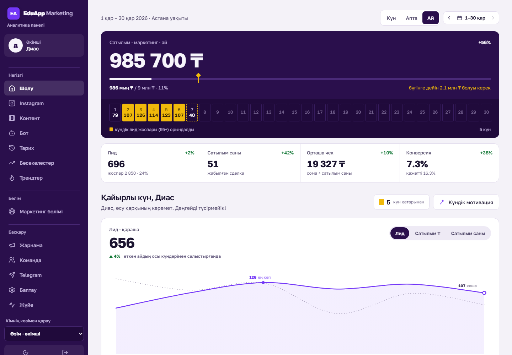

# EduApp Marketing — dashboard + Instagram Direct bot

An internal web app for the marketing team of an online school: one place for sales (amoCRM), leads, Instagram analytics, ad spend and the team's monthly plan — plus the Instagram Direct bot that turns comments and DMs into qualified leads in a Google Sheet. Built with FastAPI and server-rendered HTML, deployed as a serverless function on Vercel. Interface language: Kazakh.



## Features
**Dashboard**
- **Шолу (overview)**: revenue vs the monthly plan with a "where we should be today" marker, a strip of day tiles (gold = lead plan met), leads / deals / average check / conversion with period-over-period deltas, daily chart against the previous month, streaks, month-end forecast ("how much per day to hit the plan"), today's tasks. Day / week / month / custom range, shared across pages.
- **Instagram**: reach, views, likes, comments, saves, shares, follows/unfollows from the Instagram Graph API, cached per day; nightly snapshots build a monthly archive (**Тарих**).
- **Контент**: every post from views → comments → keyword → Direct → lead → sale → ₸ (a sale is attributed when the commenter's phone is found in a won amoCRM deal).
- **Бот**: funnel, live activity feed, collected answers, queue control, editable bot texts and per-post keyword rules, manager reply speed in Direct.
- **Жарнама (ads)**: daily spend (manual or Meta Ads API, converted with the National Bank rate), CPL and ROMI on deals whose source is targeted ads.
- **Маркетинг бөлімі**: one department plan per month (draft → approval), tasks with deadlines and undo, audit log. Roles: admin / lead / smm, with "view as employee" (read-only).
- **Reports**: morning Telegram report with auto-generated insights, shareable 1080×1350 report card (SVG → PNG in the browser), best posting time heatmap (weekday × hour), lead response speed from amoCRM events.
- **Трендтер / Бәсекелестер**: news & Google Trends / Wikipedia / YouTube feeds turned into post ideas by Gemini (with a post-filter for unsafe topics); competitor Instagram accounts via business discovery.
- **Жүйе**: health page and a watchdog that alerts the owner in Telegram (DB size, API limits, stale CRM sync, expiring tokens), gzip JSON backups.
- Light/dark theme, mobile bottom bar, reduced-motion / contrast support, no JS framework.

**Instagram Direct bot** (`app.py` webhook, `leads.py`, `conf/`)
- Comment → private reply in Direct → three questions (city, child's grade, phone); free-text answers are parsed (Kazakh/Russian city names, "5-сынып / 5 класс", any KZ phone spelling) and upserted into Google Sheets through an Apps Script web app (`sheets_script.template.gs`).
- Subscription gate, keyword mode, per-post "solo" rules, throttled DM queue to stay under Instagram limits, pause on rate-limit errors, de-duplication per person and post.
- Flow diagram: [`docs/bot-flow.html`](docs/bot-flow.html).

## Tech stack
Python 3.12 · FastAPI · httpx (async) · SQLite locally / Postgres (psycopg) in production · Instagram Graph API · amoCRM API v4 · Meta Marketing API · Google Apps Script · Telegram Bot API · Gemini / Anthropic APIs (optional) · HTML built with f-strings, inline CSS/JS and SVG charts · Vercel (serverless + cron) or Docker.

## Project structure
```
app.py            routes, Instagram webhook + bot flow, cron jobs, watchdog
home.py           overview page            dashboard.py  Instagram page
botpage.py        bot page                 archive.py    monthly archive
dept.py           plan, tasks, audit       ads.py        ad spend, CPL/ROMI
amo.py            amoCRM sync & queries    igdata.py     Instagram Graph API readers
mkt.py            plan math, forecast, report text
extras.py         report card, best time, status page
trends.py         trends + AI ideas        competitors.py competitor accounts
ask.py            "ask anything" AI page   tg.py, motiv.py, celebrate.py  Telegram report & motivation
ui.py, charts.py  design tokens, layout, SVG charts
store.py          one DB API over SQLite / Postgres
leads.py          answer parsing, Sheets sync
conf/             bot texts (texts.yml) and course catalog (trainings.tsv, demo values)
demo.py           local demo server on generated data
scripts/generate_demo_data.py   -> demo/demo_data.json
test_flow.py      end-to-end test of the bot flow and pages (offline)
DESIGN.md, PRODUCT.md           design system and product brief
```

## How to run (demo mode)
```bash
pip install -r requirements.txt
python demo.py                 # http://127.0.0.1:8000  — login: demo / demo
```
`demo.py` seeds a throwaway SQLite database from `demo/demo_data.json`, swaps the Instagram/amoCRM readers for functions that serve that data and blocks all outgoing network connections, so no keys are needed. Regenerate the data with `python scripts/generate_demo_data.py --seed 7`.

Other commands:
```bash
python demo.py --render out/   # render all pages to HTML (smoke test)
python test_flow.py            # bot-flow + page tests, expects "RESULT: ALL PASSED"
```
Production: copy `.env.example` to `.env`, fill in the keys and run `uvicorn app:app` (or deploy to Vercel; crons are in `vercel.json`).

> All data in this repository is randomly generated; brand names are anonymized.

## Қысқаша (KZ)
Онлайн мектептің маркетинг бөліміне арналған ішкі веб-қосымша: сатылым (amoCRM), лидтер, Instagram статистикасы, жарнама шығыны және бөлімнің айлық жоспары бір жерде.
Instagram Direct-боты коммент пен хаттарды лидке айналдырып, жауаптарды Google Sheets-ке жазады.
FastAPI + серверде құрастырылатын HTML, Vercel-де serverless түрінде жұмыс істейді.
Демо: `pip install -r requirements.txt`, сосын `python demo.py` (логин: demo / demo) — барлық деректер кездейсоқ жасалған.
